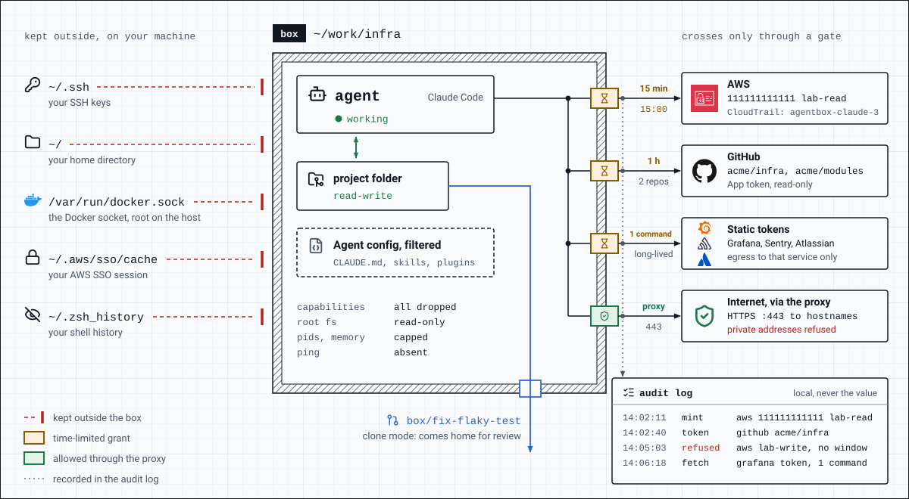

<div align="center">

# CuliBox

### Put your AI agent in a box. Hand it the cloud keys for 15 minutes. Take them back.

A self-hosted control panel to run, watch, contain and steer Claude Code sessions.

[](https://github.com/culiops/culibox/releases/latest) [](LICENSE)  

[Quick start](#quick-start) · [Features](#what-you-get) · [Security](#security-read-this) · [Ideas and bugs](https://github.com/culiops/culibox/issues)

</div>

<!-- TODO: Add docs/images/hero.gif. -->

## Why I built this

I built CuliBox because every day I have to let AI agents work inside systems containing SSH keys, cloud access and third-party services such as GitHub, Grafana, Sentry and Jira. Giving an agent a terminal is useful right up until you remember that the terminal is running as you.

I wanted one page for starting sessions, seeing what they are doing, noticing when they are stuck, checking what they cost and deciding exactly which credentials they may touch. CuliBox puts each project in its own container by default, gives the agent only the project folder as writable space and puts cloud access behind explicit gates.

It is built first for ops, cloud, DevOps and SRE work. If your agent needs to inspect infrastructure without inheriting your entire digital life, this is for you. I use CuliBox to build CuliBox: agents make changes inside CuliBox boxes, then I review them before they land. Yes, the tool works on itself. No, that does not make it magic.

## This is not my startup pitch

I did not plan to publicise CuliBox widely. I built it because I needed it, then released it because other people may have the same annoying problem.

There are no user-count fireworks, company-logo walls or claims that it will fix your organisation by Friday. If it fits your setup, use it. If it does not, do not force it.

## The problem

A normal coding agent launched from your terminal receives whatever your terminal can reach. That is often much more than the task requires.

| | Agent in your terminal | Agent in a CuliBox box |
|---|---|---|
| `~/.ssh` | Readable | Not mounted |
| Home directory | Readable | Not mounted; only the project folder is writable |
| Docker socket | Readable | Not mounted |
| AWS | Your SSO session, valid for hours | Minted per session, valid for 15 minutes, using a read-only role and narrowed further |
| GitHub | Your token, every repo it can access | One-hour GitHub App token, limited to listed repos and read-only by default |
| Grafana, Sentry and Jira tokens | Sitting in your environment | Handed to one command, with egress opened only to that service |
| Internet | All of it | Through CuliBox's proxy: port 443, hostnames only, no private addresses, and an allowlist for boxes holding credentials |
| CloudTrail | You | The agent session |
| Several sessions | Terminal tabs | One page showing which sessions are working, idle or waiting for you, and why |
| Cost | Unknown | Tokens and estimated cost per model, project and session |

One sharp edge: with no config file at all, sessions run on the uncontained host tier. Once a config file exists, boxes are the default. `culibox init` includes a step for this, so do not skip through setup like you are accepting cookie banners.



## Quick start

You need Linux or macOS and Claude Code. Boxed sessions also need Docker on Linux, or `colima` and `docker` on macOS 13+ on Apple Silicon. Intel macOS is untested.

```sh
curl -fsSLO https://github.com/culiops/culibox/releases/latest/download/setup.sh
sh setup.sh
culibox serve
```

The installer verifies checksums, installs into `~/.local/bin` without `sudo`, and runs the guided `culibox init`. CuliBox listens on `127.0.0.1:8899` and prints a login URL.

## What you get

### Watch

Run several Claude Code sessions from one browser page, on desktop or phone. Each session reports whether it is working, idle or waiting for you, including why it needs attention.

Local analytics show context, tokens and estimated cost per model, project and session. Rate-limit windows appear when a status-line hook provides them.

### Steer

Interrupt a session, restart an exited session and, when `replies_enabled` is on, answer permission prompts from the browser. Sessions run under [abduco](https://www.brain-dump.org/projects/abduco/), so closing the browser or restarting the daemon does not immediately kill the work.

The Monaco editor is good enough to work in, lets you inspect and edit files, and marks the agent's changes against git. I improve it release by release, but CuliBox is still not an IDE.

### Contain

Each boxed project gets a container with a read-only root, dropped capabilities, PID and memory caps, no host home directory, no SSH directory and no Docker socket. Only the project folder is writable, while agent configuration is filtered and credentials, history and transcripts are not copied into the box.

Clone mode lets an agent work on a private repository copy and bring branches home as `box/<branch>` for review.

### Touch the cloud

The AWS credential broker mints short-lived credentials from an SSO session through an agent role you create. It supports AWS only. GitHub access uses one-hour App tokens for listed repositories.

Grafana, Sentry, Atlassian and GitHub personal access tokens can be handed to one command at a time. These static tokens remain long-lived, so please do not mentally rename them “safe tokens.” Every mint, refusal and token fetch goes to a local audit log without recording the secret value.

### Check your setup

Run `culibox doctor` after setup and after every upgrade. It performs read-only checks and prints `PASS`, `WARN` or `FAIL` lines that are safe to paste into an issue.

### CuliBox is not an IDE

It is not VS Code, Orca or an Agent IDE, and comparing them will mostly waste your time. CuliBox has Monaco, a file browser and enough editing support to work around an agent session, but if you want to edit code all day, use your editor.

## Status

CuliBox is pre-1.0, under active development and used every day to build itself. A minor release may still change configuration keys or behaviour, so read the release notes before upgrading.

Only Claude Code is supported as an agent today. macOS support exists through CuliBox's own colima VM, but some broker and Keychain paths still need verification on a Mac.

## Security, read this

CuliBox starts shells and agents on your machine, so login is always required. The default bind is loopback, and binding all interfaces is refused unless `allow_public` is set.

A reachable CuliBox is a remote shell, not a cute dashboard. Never expose it publicly without an authenticating proxy or tunnel, add the front door's hostname to `allowed_hosts`, use a long password, and do not pretend the login page alone makes the open internet friendly.

Anyone promising a 100 percent safe agent setup is lying. Know the limits:

- The `host` tier is not contained. A host session is you, with an agent.
- The threat in scope is an agent running arbitrary userspace commands inside a box. Kernel-level escapes are out of scope.
- An agent can read any credential while that credential is given to it.
- Short-lived AWS agent-role credentials and GitHub App tokens are limited by lifetime, scope, egress controls and audit records.
- Static tokens, GitHub personal access tokens and SSO-direct credentials are long-lived and are not revoked when a session ends.
- After a boxed session, inspect untracked files and changes with `git status` and `git diff` before running host git or a host-tier session in that workspace.
- Use the AWS broker with a sandbox or lab account for now, not production.

Read the complete model and known limits in [docs/SECURITY.md](docs/SECURITY.md).

### A safer setup

- Keep the bind on loopback and reach it remotely through HTTPS on a tailnet name or an SSH port forward. See [Remote access](docs/REMOTE-ACCESS.md).
- Keep a config file so boxes remain the default.
- Use the AWS agent role, not SSO-direct. SSO-direct hands the agent your SSO role's own credentials for hours, and CloudTrail shows you.
- Turn on the encrypted store. See [Store](docs/STORE.md).
- Bind host services that boxes must not reach to `127.0.0.1`.
- Run CuliBox on a host where you trust the other accounts.
- Run `culibox doctor` after setup and after every upgrade.

### No guarantees

CuliBox is Apache-2.0 software, provided as is and without warranty. It is still developing, and nothing here is guaranteed to be 100 percent safe. If somebody tells you an agent can receive shell access and credentials with zero risk, they are selling nonsense.

Damage caused by an agent acting through credentials or access you granted on your setup is your risk. A security hole in CuliBox itself is mine to fix. Report it privately through [`.github/SECURITY.md`](.github/SECURITY.md), never in a public issue.

## FAQ

### Can I use another agent?

Not today. Only Claude Code is supported.

### Does the credential broker support GCP or Azure?

No. AWS only.

### Do I need AWS?

No. AWS access is optional. You can run sessions without granting AWS credentials.

### Will you build feature X?

Maybe. Open an [issue](https://github.com/culiops/culibox/issues) and explain the problem, not just the button you want.

### Does data leave my machine?

CuliBox is self-hosted, and its audit log and analytics are local. Agents still communicate with their model API, which for Claude Code means Anthropic's API, and configured integrations talk to the services you allow.

## Contributing

Send bug reports and ideas through [issues](https://github.com/culiops/culibox/issues). Please do not open a pull request. Outside pull requests are closed by hand, with thanks.

Changes to CuliBox are made by agents inside CuliBox boxes and reviewed before landing. That is the workflow I use, so useful problem reports and clear proposals help more than unsolicited code. See [CONTRIBUTING.md](CONTRIBUTING.md).

<details>
<summary><strong>Documentation</strong></summary>

| Doc | What it covers |
|---|---|
| [Install](docs/INSTALL.md) | Requirements, the installer, release tarballs, building from source, macOS release verification. |
| [Features](docs/FEATURES.md) | Every feature in detail: boxes, config bundle, box shell, credentials. |
| [Configuration](docs/CONFIG.md) | The data root, every `config.json` key, profile fields. |
| [Clone mode](docs/CLONE-MODE.md) | Agents working on a private copy of a repo; bringing branches home. |
| [Reading other repos](docs/CONTEXT-PATHS.md) | `context_paths`: read-only mounts of other folders. |
| [CLAUDE.md imports](docs/CLAUDE-MD-IMPORTS.md) | How files your `CLAUDE.md` imports reach a box. |
| [GitHub access](docs/GITHUB.md) | GitHub App tokens for `git` and `gh` in a box. |
| [Static tokens](docs/STATIC-TOKENS.md) | Long-lived service tokens, self-hosted services, GitHub PATs. |
| [AWS access](docs/AWS.md) | Several AWS accounts per session, write windows, the opt-in SSO-direct mode. |
| [AWS agent role](docs/aws/agent-role/README.md) | The Terraform for the IAM role the broker assumes. |
| [Store](docs/STORE.md) | The encrypted value store and its commands. |
| [Security model](docs/SECURITY.md) | What is protected, how, and the known limits. |
| [Remote access](docs/REMOTE-ACCESS.md) | Reaching CuliBox from another machine, and why notifications need HTTPS or localhost. |
| [macOS](docs/MACOS.md) | Install, the colima-based boxed tier, rotating credentials. |
| [Docker](docs/DOCKER.md) | Running CuliBox itself in a container, and keeping sessions across restarts. |
| [Upgrading](docs/UPGRADING.md) | What an upgrade keeps, the automatic backup, rolling back, and installs from the agent-box days. |
| [Contributing](CONTRIBUTING.md) | How to file a bug or propose a change. Issues only. |

</details>

## License

Apache-2.0. See [LICENSE](LICENSE).
